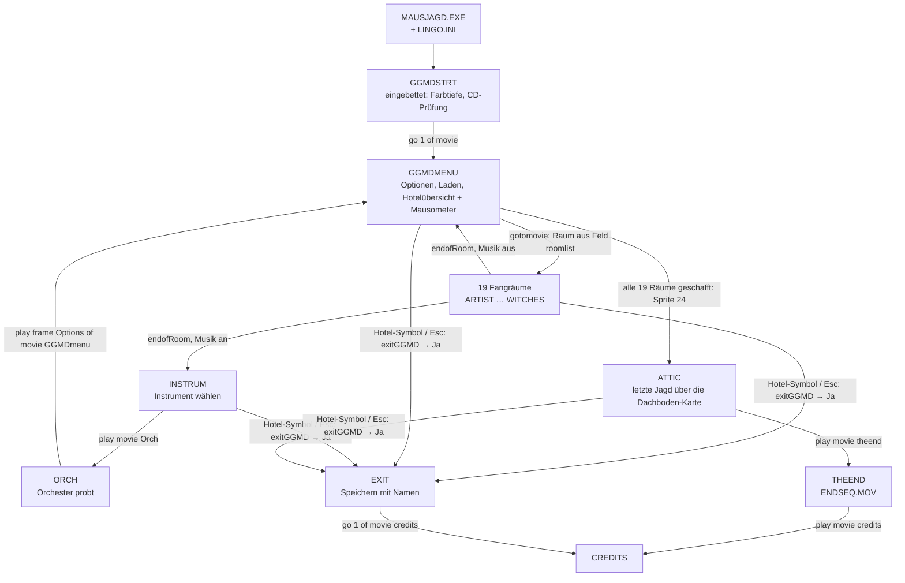

# Spielablauf

Stand: T2.3. Quelle: dekompilierter Lingo-Code (`analysis/lingo/`), Handler-Namen wie dort.

## Film-Graph

## Filme

| Film | Rolle | Video | Besonderheiten |
|---|---|---|---|
| `GGMDSTRT` (in EXE) | Start | – | `startit`, `checkifcd` (FileIO auf `D:\lingo.ini`), `puppetSound "theme.aif"` |
| `GGMDMENU` | Menü und Hotelübersicht | `GERINTRO.MOV`, `CATHELP6.MOV` | Level (`slow`/`medium`/`fast` = 10/5/0 Fallen, Tempo 8/12/16), Musik an/aus, Laden (`loadgame`, `selectedgame` über `the mouseLine`), Mausometer (`detecter`, `alarm`, `select` per `rollOver`) |
| 19 Räume | Fangräume: ARTIST, BALLROOM, BAR, BATHROOM, BUSINESS, DINING, EXERCISE, FARMER, KITCHEN, LIBRARY, MADSCI, NEWLYWED, PLAYROOM, PLUMBER, PRESBED, PRESLIV, SLOBS, SNOOKER, WITCHES | `<RAUM>.MOV` (BALLROOM: `DANCE.MOV`, SLOBS: `SLOB.MOV`, WITCHES: `WITCH.MOV`) | Logik in `SHARED.DXR` (`startsequence`, `clicked`, `caught`, Fallen), siehe `mouse-catching.md` |
| `SHARED` | Shared Cast | `CATHELP7/9.MOV`, `CATHEL10/11.MOV` | Gemeinsame Handler, Maus-Bitmaps `mice####`, Fallen, Hilfe des Katers (`help`), Beenden (`exitGGMD`) |
| `INSTRUM` | Musikzimmer | – | Instrument-Buttons als Cast-Skripte, Soli aus `gsolospath` |
| `ORCH` | Orchesterprobe | – | spielt `MUSIC/<BUILD>/<INSTRUMENT>.AIF` |
| `ATTIC` | Finale | – | Dachboden-Karte mit 6 Bereichen (`hideroom`, `rollovermap`, `clickedoutsidemap`) |
| `THEEND` | Endsequenz | `ENDSEQ.MOV` (18 MB) | – |
| `EXIT` | Beenden und Speichern | – | editierbares Textfeld (Sprite 11) für den Namen, Return (keyCode 36) bestätigt, FileIO `append` auf `saveinfo.txt` |
| `CREDITS` | Abspann | – | – |
| `BALLROOM` | Fangraum mit eigenen Handlern | `DANCE.MOV` | `ballroomclicked` statt `clicked` |

## Globale Zustände (Auswahl)

| Global | Bedeutung |
|---|---|
| `spritelist` | noch nicht geschaffte Räume (Sprite-Nummern 5–23 auf der Hotelübersicht) |
| `miceCaught` | gefangene Mäuse; bei 5, 10 und 15 steigt `mytempo` um 2 |
| `mytempo` | Tempo der Laufanimation (Level 1/2/3 = 8/12/16 fps) |
| `numtraps`, `trapsdone` | verbleibende und benutzte Fallen |
| `music`, `theBuild`, `playList` | Musik an/aus, Orchester-Variante (BUILD1–3), bisherige Instrumente |
| `WhereAmI` | `menu` / `bedroom` (Raum) / `instrum` / `orch` / `attic`; steuert Hilfe und Beenden |
| `thecdpath`, `thehdpath`, `gsounddrive`, `gmusicpath`, `gsolospath` | Pfade aus `LINGO.INI` |
